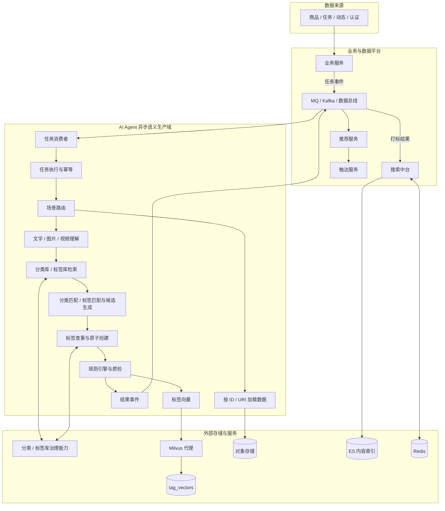
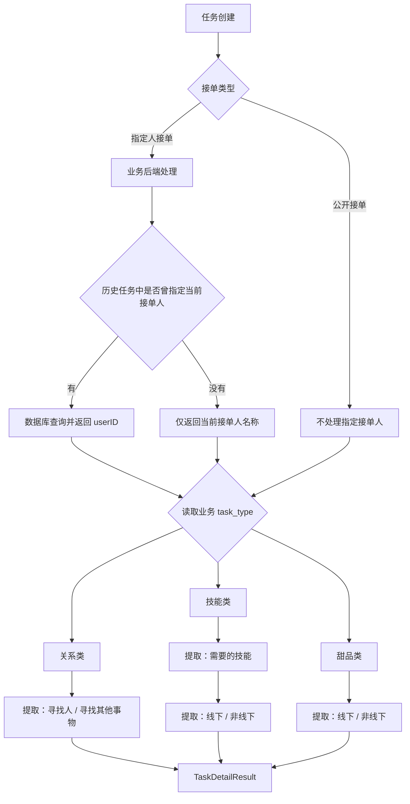

# AI Agent 与推荐搜索系统架构设计

| 项目 | 内容 |
|------|------|
| 版本 | v0.11.0 |
| 状态 | 基线对齐稿；S4 商品打标 MVP 已实现；A026 已确认，A006/A007 等仍待评审 |
| 更新日期 | 2026-08-19 |
| 需求基线 | [推荐系统-产品文档](../推荐系统-产品文档.docx) · [动态 AI Agent（分类和标签）](../动态AI%20agent（分类和标签）.docx) · 2026-07-20 用户纠正 |
| 补充需求 | [任务分类需求图](../任务分类需求图.png) |
| 架构参考 | [推荐搜索整体架构设计](../推荐搜索整体架构设计.md) · [推荐搜索整体架构设计图](../推荐搜索整体架构设计图.png) · [AI Agent交互协议设计](../AI%20Agent交互协议设计.md) |
| 产品定义 | [PRD](./PRD.md) |

> 决策优先级：需求基线定义产品行为和验收；架构参考定义目标链路。二者冲突时以需求为准。本文中的“建议”表示待评审技术方案，不代表已批准排期。

## 0. 冲突与待确认事项

状态说明：**冲突** = 需求基线之间存在直接矛盾；**未确认** = 基线未覆盖，需要产品补充；**部分确认** = 已有基线文档的部分证据支持，方向明确但细节仍需产品/技术补充；**暂定** = 已有可执行的默认方案，正式规则待后续冻结；**已确认** = 已有明确结论，可直接实施。

### 0.1 待确认与冲突事项

| 编号 | 状态 | 问题 | 建议方案 |
|------|------|------|----------|
| A007 | 未确认 | 标签治理能力是否独立建设 Tag Service | Agent 创建标签所需查询、查重、原子创建和审计接口必须先冻结，再决定部署形态 |
| A009 | 部分确认 | Query Embedding 由谁提供 | 已确认不属于 Agent（依据模块交互方式表，用户搜索链路不与 Agent 交互）；具体由搜索侧哪个子模块提供仍待确认 |
| A024 | 暂定 | 历史接单人数据库查询键 | 查询适配器配置化，正式键冻结前不在 Agent 中实现名称匹配规则；架构已预留配置入口 |
| A025 | 已确认 | 任务类型正式业务编码 | 输出字段为 `biz_task_type`，schema 1.0 固定 `relationship/skill/dessert`；仅使用 Agent 内部注册表，编码变化随 TaskDetailResult schema 升级 |

在 A006 以及合法 JSON Schema 冻结前，不建议进入 S3 全量开发。T1 的 A025 已关闭；历史接单人查询键 A024 仍由后端继续确认。

### 0.2 已确认结论

| 编号 | 问题 | 结论 |
|------|------|------|
| A001 | 动态视频是否由 Agent 处理 | **已确认**：动态需求支持视频，Agent 负责视频动态的多模态理解与打标；管线包含抽帧、帧理解/OCR 及可选 ASR，见 [6.1](#51-多模态感知) |
| A002 | 二级分类字典为空时如何处理 | **已确认**：架构覆盖一级/二级分类完整输出能力；二级字典暂空时输出 `null` 且禁止自创，待产品补全字典后无需改架构即可生效，见 [6.2](#52-分类匹配) |
| A003 | 标签数量口径 | **已确认**：统一输出 0～5 个标签，保留 `Final_Conf >= 0.50` 的前 5 个并降序排列，见 [6.3](#53-标签匹配) |
| A004 | 置信度阈值 | **已确认**：使用 `Final_Conf >= 0.50` 作为过滤阈值，见 [6.5](#55-规则引擎) |
| A005 | 证据真实性边界 | **已确认**：80% 边界统一为 `>=80%` 与 `50%～<80%`，见 [6.5](#55-规则引擎) |
| A008 | 持久化内容向量是否参与召回 | 不建设 `content_vectors`；只有标签向量入库参与召回，内容语义表示仅为推理临时对象。依据：《推荐搜索整体架构设计》商品/任务/动态打标步骤表，内容理解、标签抽取两步存储列均为空，仅标签向量落 Milvus |
| A012 | S1/S2 是否进入 Agent 范围 | **已确认**：S1 职业认证解析、S2 技能认证解析纳入 Agent 开发范围；输入输出规格和验收标准待产品补充，见 [5](#5-场景化处理管线) |
| A013 | 用户画像是否进入 Agent 范围 | **已确认**：用户画像打标、用户向量生成不纳入本 Agent；由画像服务或大数据平台负责。历史建议使用的 S4 编号已释放，不再指代用户画像 |
| A014 | ES 索引唯一写入方 | 搜索中台是 ES 唯一写入方，Agent 只发布结果事件、不直接写 ES。依据：《推荐搜索整体架构设计》模块交互方式表与数据同步步骤 |
| A015 | 推送文案由谁负责 | **已确认**：推送文案不由 Agent 负责，由触达/推荐服务基于模板或业务规则组装，见 [9.3](#83-推送文案a015-已确认) |
| A016 | Agent 是否可创建分类和标签 | Agent 不创建分类；标签查重无可复用项后可创建新标准标签 |
| A017 | 指定人历史查询与返回 | 历史任务曾指定当前接单人时查询并返回数据库 userID，否则只返回当前名称 |
| A018 | 指定人是否受限制 | 指定人接单不限制指定对象；业务后端仍执行通用权限和状态校验 |
| A019 | 指定人任务是否执行任务类型分支 | 指定人和公开接单均由 T1 Agent 判断关系类、技能类或兜底类，再提取重点信息 |
| A021 | 服务方式枚举 | 使用 `offline/non_offline`；非线下包括远程或其他非现场方式 |
| A022 | 关系类目标 | 区分寻找某个人与寻找其他事物，即 `person/other_object` |
| A020 | 甜品类业务边界和提取字段 | **已确认**：甜品类为兜底分类（非关系类、非技能类的任务均归入此类），不细分子类型；固定只提取 `service_mode（offline/non_offline）`，与技能类提取逻辑相同，不设扩展字段 |
| A023 | T1 是否使用标签、分类和置信度规则 | 不复用 S3 标签、分类和置信度规则；T1 Agent 只在三个固定业务分支中自行判断，再提取重点信息 |
| A006 | 标准标签还是别名作为最终输出 | 标准标签还是别名作为最终输出 | 标准标签及别名标签均可作为最终输出 |
| A027 | S4 商品打标场景与规则 | **已确认**：S4 为独立商品打标场景；标题/图片至少提供一种，图片 0～5 张并走 OCR+Vision，标题图片冲突时标题优先且进入审核；只输出单一一级/二级路径，允许 unknown；二级叶子混合召回、父级映射一级；模型 A 分类、模型 B 独立复核，自动通过阈值 0.85；Agent 只返回候选新分类建议和搜索词，不创建分类、不写搜索索引 |
| A026 | MQ 二值状态与业务决策 | **已确认**：外层 `status` 只表达技术完成；合法 `classified/unknown/need_review` 均为 `success`，业务状态由 `payload.decision` 和 `need_manual_review` 表达；未产出合法结果才为 `fail` |

---

## 目录

0. [冲突与待确认事项](#0-冲突与待确认事项)
   - [0.1 待确认与冲突事项](#01-待确认与冲突事项)
   - [0.2 已确认结论](#02-已确认结论)
1. [核心结论](#1-核心结论)
2. [能力范围与状态](#2-能力范围与状态)
3. [总体架构](#3-总体架构)
4. [数据与职责边界](#4-数据与职责边界)
5. [场景化处理管线](#5-场景化处理管线)
6. [S3 动态分类与标签](#6-s3-动态分类与标签)
7. [标签与向量](#7-标签与向量)
8. [搜索链路](#8-搜索链路)
9. [推荐与触达](#9-推荐与触达)
10. [MQ 与结果一致性](#10-mq-与结果一致性)
11. [Job、可观测性与安全](#11-job可观测性与安全)
12. [建议实施顺序（非承诺排期）](#12-建议实施顺序非承诺排期)

---

## 1. 核心结论

1. **AI Agent 是异步语义生产者**：负责理解动态内容，产出分类、标签、置信度、证据和离线标签向量。
2. **搜索与推荐在线链路不调用 LLM**：Trie、轻量 Query Embedding、Milvus ANN、ES、GBDT、MMR 和规则均可在线执行。
3. **分类只匹配、标签可创建**：Agent 不创建分类；标签优先复用，查重无可复用项后允许创建新标准标签。
4. **规则引擎属于动态打标基线**：最终输出使用规则修正后的置信度，而不是只依赖模型自评分。
5. **S1/S2/S3/S4/T1 是架构场景编号**：S4 已确认用于商品打标，历史用户画像建议不再占用 S4；用户画像打标仍不纳入本 Agent。S1/S2 已确认纳入开发范围，T1 流程已明确。
6. **标签向量独立存储**：`tag_vectors` 保存稳定标签向量。用户向量若存在，由画像服务维护，不属于本 Agent。
7. **内容语义表示与持久化内容向量分开处理，且不建设持久化 `content_vectors`**：推理过程只生成临时表示；《推荐搜索整体架构设计》商品/任务/动态打标步骤表中仅标签向量落 Milvus，内容理解和标签抽取两步的存储列均为空，据此确认只有标签向量参与召回（见 [A008](#02-已确认结论)）。
8. **分类/标签库治理能力必须存在，但是否建设独立 Tag Service 待架构评审**。
9. **任务流程采用“后端确定性规则 + Agent 三分支判断与提取”**：历史订单和用户 ID 由业务后端判断；Agent 根据文本和图片判断关系类、技能类或兜底类，再提取重点信息，不复用 S3 标签与置信度规则。
10. **ES 是搜索中台独占写入，Agent 只发结果事件**：《推荐搜索整体架构设计》的模块交互表与数据同步步骤均显示标签变化事件经 MQ 到搜索中台后才更新 ES，Agent 不直接写索引（见 [A014](#02-已确认结论)）。
11. **动态视频由 Agent 处理，推送文案不由 Agent 负责**：视频动态走 S3 多模态管线（抽帧、帧理解、可选 ASR）；推送文案由触达/推荐服务基于模板或业务规则组装（见 [A001](#02-已确认结论)、[A015](#02-已确认结论)）。

---

## 2. 能力范围与状态

### 1.1 Agent 能力

| 能力 | 输入 | 输出 | 状态 |
|------|------|------|------|
| S3 动态分类与标签 | 文字、图片、视频或混合内容 | 一级/二级分类、0～5 标签、最终置信度、证据 | 已确认，含视频（A001） |
| S4 商品打标 | 可选标题、0～5 张商品图片（至少一种非空） | 唯一一级/二级分类路径或 unknown、综合置信度、审核原因、搜索词或候选分类建议 | MVP 已实现；生产富化/验收进行中（A027） |
| 内容多模态理解 | 文字、图片、视频帧，可选视频音轨 | 临时内容语义表示 | 已确认，视频纳入 S3 基线 |
| 规则质检 | 模型候选、证据、分类/标签库 | 合法结果、修正置信度、待审核原因 | 需求基线 |
| 标签向量生成 | 标签名称、描述、别名、代表内容 | `tag_vector` 和模型元数据 | 架构参考 |
| S1 职业认证解析 | 职业认证材料 | 认证标签与结构化结果（规格待补充） | 已确认开发（A012） |
| S2 技能认证解析 | 技能认证材料 | 认证标签与结构化结果（规格待补充） | 已确认开发（A012） |
| T1 任务分支信息提取 | 接单方式、任务文本、图片、指定人名称 | `biz_task_type`、人/其他事物目标、所需技能、线下/非线下；历史 userID 或名称 | 文本+图片 MVP 已实现；固定三分支编码已确认 |

### 1.2 待确认能力速览

以下能力仍有开放问题，详细结论和建议方案统一记录在 [第 0 节](#0-冲突与待确认事项)，此处仅列出速览和对应编号。

| 能力 | 待确认问题 | 对应编号 |
|------|------------|----------|
| 标签输出格式 | 标准标签还是别名作为最终输出 | A006 |
| 标签治理部署形态 | 是否独立建设 Tag Service | A007 |
| Query Embedding 归属 | 已排除 Agent 职责，具体承接子模块待确认 | A009（部分确认） |
| T1 配置化预留 | 历史接单人查询键待冻结 | A024（暂定）；A025 已关闭 |

> 动态视频（A001）、二级分类架构覆盖（A002）、S1/S2 开发范围（A012）、用户画像不纳入 Agent（A013）、推送文案归属（A015）、甜品类边界（A020）、S4 商品打标（A027）及 A003～A005 已确认，结论见 [0.2](#02-已确认结论)。持久化内容向量（A008）、ES 写入方（A014）同见 0.2。

### 1.3 不属于 Agent

| 能力 | 负责系统 |
|------|----------|
| 搜索联想、Query 分词、关键词提取 | 搜索中台 |
| 在线 Query Embedding | 不属于 Agent（已确认，见 A009）；由搜索侧内部提供，具体子模块待确认 |
| Milvus 在线 ANN 查询 | 搜索/推荐服务 |
| ES 关键词检索和标签过滤 | 搜索中台 |
| GBDT 精排、MMR 重排、去重、缓存 | 搜索/推荐服务 |
| 用户行为采集、Hive/HBase 存储、Spark/Flink 聚合 | 大数据平台 |
| 用户画像打标、用户向量生成 | 画像服务或大数据平台（已确认，见 A013） |
| 曝光过滤、用户过滤、频控和触达 | 推荐/触达服务 |
| 推送文案组装 | 触达/推荐服务（已确认，见 A015） |
| 分类新增，以及标签改名、停用、合并 | 分类/标签治理系统或运营后台；Agent 仅可按治理接口创建新标准标签，详见 [4.1](#41-分类标签库治理) |

---

## 3. 总体架构



### 2.1 图中入口解释

架构参考图同时画有“数据源直接进入 Agent”和“MQ/数据总线进入 Agent”。统一解释为：

- MQ 负责触发任务，只传业务 ID、数据类型、版本和必要上下文；
- Agent 再通过业务读取接口或对象存储加载原始文字、图片、视频；
- 原始数据读取不代表绕过 MQ 直接触发 Agent。

### 2.2 MQ、Kafka 与数据总线

本文将三者统一视为事件基础设施的逻辑角色：

- 任务队列：传递 Agent 异步任务；
- 事件总线：发布打标、标签字典、索引和推荐事件；
- 行为流：承载用户行为供大数据消费。

是否使用同一 Kafka 集群、不同 Topic 或独立队列，由基础设施设计决定。

---

## 4. 数据与职责边界

| 数据 | 事实源/负责人 | Agent 权限 |
|------|---------------|------------|
| 商品、任务、动态、认证原始数据 | 业务服务 / 对象存储 | 只读 |
| 发布人、接单人、历史订单和接单权限 | 用户/订单/任务业务服务 | 不直接判定；只接收后端提供的结构化结果 |
| 一级/二级分类字典 | 分类治理系统，归属待确认 | 只读查询 |
| 标签、别名、分组和状态 | 标签治理系统，归属待确认 | 查询、近义查重；无可复用项时创建新标准标签 |
| 手工标签 | 业务服务 / 用户内容数据 | 读取并按规则合并，不改写来源 |
| 标签向量 | Milvus 代理 / `tag_vectors` | 离线生成并通过代理写入 |
| 用户标签画像 | 画像服务或大数据平台 | 不负责；不写入、不覆盖 |
| 用户向量 | 画像服务 / Milvus `user_vectors` | 不负责 |
| ES 内容文档 | 搜索中台 | 不直接写，只发布结果事件 |
| 任务进度与重试 | Kafka Offset / 分区所有权 | 消费组读写 |
| 技术审计 | 日志 / 可观测性 | 写 |

### 3.1 分类/标签库治理

分类和标签采用不同权限边界：

- 分类库对 Agent 只读，Agent 不得创建分类；
- 标签库允许 Agent 查询、查重，并在无可复用项时创建新标准标签。

治理能力至少包括：

- 按名称、ID、场景和状态查询；
- 一级/二级分类层级查询；
- 标签及别名联合匹配；
- 标签向量近义检索；
- 归一化名称唯一约束；
- 幂等键和原子创建；
- 并发创建冲突后回读已有标签；
- 稳定 `tag_id` 分配；
- 来源 Job、证据、模型和 Prompt 审计；
- 词库版本读取；
- 变更事件订阅和缓存失效。

Agent 只允许创建新标准标签，不负责标签改名、停用和合并。是否独立建设 Tag Service 尚未确认；建议先冻结抽象接口，再决定部署形态，不得将 Agent 本地存储作为词库事实源。

---

## 5. 场景化处理管线

通用管线不能强制覆盖所有场景，Router 必须按场景选择步骤。

```text
S3 动态：
加载内容 → 多模态理解 → 分类/标签库检索
  → 分类只读匹配 → 标签匹配或候选生成
  → 标签查重/原子创建 → 规则引擎 → 合法 JSON → 结果事件

S1/S2 认证（已确认纳入开发，规格待补充）：
加载认证材料 → OCR/视觉理解 → 对应词库检索
  → 标签匹配或候选生成 → 标签查重/原子创建
  → 规则校验 → 结果事件

T1 任务分支信息提取：
详细流程见 5.1，此处仅概述——业务后端处理接单方式和指定人查询，
所有任务再按已有 task_type 分支提取重点信息，产出 TaskDetailResult。

S4 商品打标（MVP 已实现）：
加载标题/商品图片 → OCR+Vision → 二级叶子类目混合召回
  → 模型A选择或unknown → parent_category_id映射一级
  → 模型B独立复核 → 确定性校验 → 分类结果/搜索词/候选分类建议事件
```

### 4.1 T1 任务分支信息提取

#### 4.1.1 总体流程



#### 4.1.2 后端与 Agent 边界

业务后端负责：

- 根据结构化 `accept_mode` 分流；
- 指定人接单时不限制指定对象；
- 查询当前发布人以前发布的任务；
- 判断历史任务是否曾指定当前接单人；
- 曾指定时查询数据库并返回该接单人的 `userID`；
- 未曾指定时只返回当前接单人名称；
- 权限、黑名单、订单状态和实际派单；
- 保存接单人查询结果和任务明细。

Agent 根据任务描述与图片先判断固定三分支，再提取重点信息：

- 关系类：提取寻找对象是某个人还是其他事物，以及目标描述；
- 技能类：提取所需技能以及线下或非线下；
- 甜品类（兜底类）：非关系类、非技能类的任务均归入此类，不细分子类型；固定提取线下或非线下，提取逻辑与技能类相同。

Agent 负责固定三分支判断，但不查询订单库、不处理指定人 `userID`，也不决定接单权限。

#### 4.1.3 分支与提取策略

- `biz_task_type` 是 T1 Agent 的固定三分支判断结果，与 S3 的内容分类/标签体系无关。
- T1 分支逻辑独立于动态分类、标签和置信度体系，不套用第 6 节的规则引擎。
- 关系类输出 `person/other_object` 和具体目标描述。
- 技能类输出技能列表；是否进一步映射技能标签由后续匹配链路决定，不影响本分支结果。
- 技能类和甜品类输出 `offline/non_offline`。
- Agent 只能输出 relationship/skill/dessert 三个内部固定值；不得创建新分支。

#### 4.1.4 建议数据契约

Agent 任务输入：

| 字段 | 说明 |
|------|------|
| `task_id/biz_id/data_version` | 任务标识与版本 |
| `publisher_id` | 发布人 ID，供后端查询历史任务 |
| `accept_mode` | `public/specified`，必填；其他值在模型调用前以不可重试错误拒绝 |
| `description` / `body` / `text` | 任务描述与正文；冲突时优先于图片 |
| `attachments[]` | 首版只支持图片附件 |
| `specified_assignee_name` | 指定人名称；指定人接单时必填 |

指定人历史查询由业务后端执行，查询键通过配置适配器注入（暂定，见 A024），Agent 不参与。

> `task_type` 命名提醒：本字段是业务级任务分支标识，与第 9.1 节 MQ 信封字段 `task_type`（固定取值 `mark_tag`，标识 Agent 处理协议类型）是两个不同层级的字段，避免混淆。

T1 输出 `TaskDetailResult`：

| 字段 | 说明 |
|------|------|
| `accept_mode` | 原样返回接单模式 |
| `biz_task_type` | Agent 判断的 relationship/skill/dessert 固定三分支；随 TaskDetailResult schema 版本管理 |
| `relation_target` | `person/other_object/null` |
| `relation_target_detail` | 要寻找的人或其他事物描述 |
| `required_skills[]` | 技能类需要的技能 |
| `service_mode` | `offline/non_offline/null` |
| `extraction_errors[]` | 重点信息缺失或无法提取的原因 |

指定人历史订单结果由后端追加：

| 字段 | 说明 |
|------|------|
| `specified_assignee_name` | 当前指定接单人名称 |
| `historically_specified` | 历史任务是否曾指定该接单人 |
| `returned_user_id` | 曾指定时从数据库查询并返回，否则为空 |
| `returned_name` | 未曾指定时返回当前名称，否则为空 |

#### 4.1.5 可靠性与降级

- 指定人路径不依赖 LLM；订单或用户服务失败时返回可重试业务错误。
- 公开接单和指定人接单都继续执行任务类型分支。
- Agent 分支判断或重点信息提取失败时返回结构化 `extraction_errors[]`，按错误类型进入失败、部分成功或人工审核。
- 同一任务按 `data_version` 保证幂等，防止旧提取结果覆盖新编辑内容。
- 人工修改结果应记录来源，并可作为后续评测样本。

### 4.2 S4 商品打标（A027 已确认）

S4 是独立于 S3 动态内容打标的固定管线。S4 只处理商品分类和商品搜索词，不创建标签，不写 ES/搜索索引，不承担用户画像职责。

#### 4.2.1 输入与感知

- 标题可选；商品图片数组允许 0～5 张，典型为 3～5 张；标题和图片不得同时为空；
- 不区分主图和详情图，所有图片均作为同一商品证据；
- 首期原生支持 JPEG、PNG、WebP、GIF 静态首帧，其他格式转码后进入管线；
- 图片执行 OCR + Vision，单图失败允许降级且必须记录；
- 标题和图片冲突时以标题为分类依据，同时写入 `modality_conflict`，结果进入人工审核。

#### 4.2.2 类目快照与稳定标识

类目来源为 [在场电商平台商品分类信息.xlsx](./在场电商平台商品分类信息.xlsx)。当前快照有 41 个一级类目和 259 条一级/二级路径，但只包含名称；导入服务必须分配并持久化 `category_id`、`parent_category_id`、`taxonomy_version` 和状态。

二级名称不是唯一键：`办公家具`、`手机配件` 均跨一级类目重名，且存在 `宠物用品/宠物用品` 父子同名路径。所有召回、模型选择、输出和版本回放必须使用类目 ID 与完整路径。

LLM 生成类目描述、正反例、关键词和分类规则后不经过运营审核，直接进入机器门禁：Schema 完整性、名称不可修改、父子关系、重复/冲突、包含/排除自洽性、敏感内容和版本一致性。重试后仍失败的类目不得发布到索引。

#### 4.2.3 分层召回、双模型与系统决策

```text
LOAD → OCR+VISION → PRODUCT PROFILE → QUERY FEATURES
  → LEVEL2 HYBRID RETRIEVAL(exact/alias/BM25/vector + RRF, Top 20)
  → MODEL A SELECT(level2_category_id | unknown)
  → PARENT RESOLUTION(parent_category_id → level1_category_id)
  → MODEL B REVIEW(不接收模型A置信度和详细理由)
  → DETERMINISTIC VALIDATION → DECISION → PUBLISH
```

- 一个商品只允许一个一级分类和一个二级分类，不考虑多主体和套装；
- 模型不得生成候选外 ID，候选均不符合时允许返回 `unknown`；
- 一级分类不独立检索或由模型生成，必须由选中二级类目的父级映射得到；
- 模型 B 使用不同模型或不同模型系列；模型 A/B 必须同意同一二级类目；
- 最终 `confidence = min(model_a_confidence, model_b_confidence)`，表示商品与完整一级/二级路径的综合关联度；
- 自动通过要求最终置信度 `>= 0.85` 且无父子非法、排除规则、模态冲突或严重降级；否则返回 `unknown` 或 `need_manual_review=true`。

#### 4.2.4 输出与外部责任

S4 输出 `ProductLabelResult`，至少包含：`product_id`、`taxonomy_version`、一级/二级 ID 与名称、`confidence`、`decision`、`need_manual_review`、`reason_codes[]`、`evidence_refs[]`、模型/Prompt 版本、可选 `search_terms`、可选 `category_suggestion`。

- 只有分类自动通过时才生成商品搜索词；Agent 只发布搜索词，搜索中台负责写索引；
- Agent 不创建正式分类；仅当现有分类确实缺失、且原因不是信息不足或解析失败时，返回候选分类建议；
- Agent 不负责审核结果回流，本阶段只输出打标与审核所需信息。

---

## 6. S3 动态分类与标签

### 5.1 多模态感知

```text
文字 ─────────────→ 原文整理 ───────────┐
图片 ─────────────→ 视觉理解 + OCR ─────┤
视频 ─────────────→ 抽帧 + 帧理解/OCR ──┼→ 临时 ContentBundle
视频音轨（启用时）→ ASR ────────────────┘
```

`ContentBundle` 建议记录：

- 原始文字、OCR 片段、视觉描述；
- 视频帧和可选 ASR 转写；
- 实际存在及成功解析的模态；
- 失败原因、降采样/截断标记和时间戳。

该对象是推理过程中的临时语义表示，不等同于持久化 `content_vector`。

### 5.2 分类匹配

1. 只能查询给定分类库，禁止创建。
2. 输出一个一级分类和一个二级分类。
3. 二级字典未冻结前，二级分类允许为空。
4. 最高最终置信度 `<0.50` 时输出：
   - 一级分类“未分类”；
   - 置信度 `0.00`；
   - 二级分类 `null`。
5. “全部”是 UI 筛选项，不进入分类候选。

### 5.3 标签匹配

1. 优先查询标准标签、别名和向量近义项。
2. 存在同义或可复用近义标签时，必须复用已有 `canonical_tag_id`。
3. 无可复用项时，允许创建新标准标签；不得创建别名标签代替标准标签。
4. 创建必须使用归一化名称唯一约束、幂等键和原子操作；并发冲突后回读复用。
5. 新标签创建成功并返回稳定 `tag_id` 后，可用于当前结果，来源标记为 `created`。
6. 当前建议输出标准标签；别名输出策略待确认（[A006](#01-待确认与冲突事项)）。
7. 使用规则修正后的最终置信度过滤。
8. 保留 `Final_Conf >= 0.50` 的前 5 个并降序排列。
9. 无有效匹配且不满足创建条件时返回 `[]`。

自动创建的最低置信度、是否立即启用和低置信候选是否进入人工审核，仍需产品确认。

### 5.4 手工标签合并

建议在业务服务侧完成：

- AI 标签和手工标签分别记录来源；
- 标准标签按稳定 ID 去重；
- 用户自定义且未归一的标签进入“未分组”；
- 展示优先级和覆盖关系由产品确认。

Agent 不应把用户自定义标签自动写入全局标签库。

### 5.5 规则引擎

校验维度：

| 维度 | 校验内容 |
|------|----------|
| 证据真实性 | 引用的文字、画面或行为是否实际存在 |
| 标签自洽性 | 分类/标签与证据是否一致 |
| 输出稳定性 | JSON、在库状态、数量、顺序、分数范围 |

最终置信度：

```text
Final_Conf =
  LLM 自评分
  × min(证据真实性系数, 标签自洽性系数, 输出稳定性系数)
```

处理规则：

- 阈值判断使用 `Final_Conf`；
- 完全无法解析的候选系数置零并丢弃；
- 分类无有效候选时回退“未分类”；
- 标签无有效候选时返回空数组；
- 证据真实性 80% 边界统一为 `>=80%` 与 `50%～<80%`；
- 系数取值、自动修复和人工审核阈值待产品冻结。

---

## 7. 标签与向量

### 6.1 稳定标签向量

`tag_vectors` 中每个规范标签保存一个稳定向量。建议输入为：

- 标准标签名称；
- 标签描述；
- 别名；
- 经治理的代表内容。

单条内容任务不得用内容上下文直接覆盖已有全局标签向量。仅在以下情况生成或重算：

- Agent 创建新标签；
- 运营修改已有标签；
- 别名或代表内容集合更新；
- Embedding 模型版本迁移。

建议 Schema：

| 字段 | 说明 |
|------|------|
| `tag_id` | 稳定标签 ID |
| `vector` | 标签向量 |
| `tag_name/category/level/status` | 标签元数据 |
| `embedding_model/version/dimension` | 向量模型元数据 |
| `dictionary_version` | 词库版本 |
| `updated_at` | 更新时间 |

向量维度不写死，必须由模型配置决定。

### 6.2 内容向量（A008 已确认）

架构图出现“内容本身向量化”和“内容向量输出”，而文字搜索链路只依赖标签向量。《推荐搜索整体架构设计》商品/任务/动态打标步骤表中，“内容理解”“标签抽取”两步的存储列均为“—”，只有“向量生成”（标签向量）落 Milvus，据此确认：

- 内容语义表示（`ContentBundle`）仅是推理过程中的临时对象，**不持久化**；
- **不建设 `content_vectors`**，内容本身不直接参与 ANN 召回；
- 若未来产品需要启用直接内容 ANN，需重新评审并另行定义 collection、主键、更新/删除、召回融合和成本，属于对当前基线的变更而非默认路径。

### 6.3 用户向量（不属于 Agent）

用户向量生成与 `user_vectors` collection 由画像服务或大数据平台维护，**不纳入本 Agent**（见 [A013](#02-已确认结论)）。推荐链路若使用 `user_vector`，由画像服务写入、推荐服务读取，Agent 不生产、不写入。

---

## 8. 搜索链路

```text
用户输入
  → Trie 搜索联想
  → 分词 / 停用词 / 关键词提取
  → Redis 查询 Query→标签缓存
  → 未命中：Query Embedding
  → Milvus tag_vectors ANN TopK
  → 标签 ID + BM25 查询 ES
  → GBDT 精排 / 去重 / MMR / 业务规则
  → 返回并缓存
```

### 7.1 Query Embedding（A009 部分确认）

架构参考直接使用 `query_vector`，但未给出生成方。《推荐搜索整体架构设计》的“模块交互方式”表中，“其他模块 → AI Agent”只列出打标任务这一条交互，用户搜索链路（Trie/分词/标签向量查询/ES）没有任何一步与 Agent 交互，据此可确认 **Query Embedding 不属于 Agent 职责**；具体由搜索侧哪个子模块提供仍待确认。建议：

- 搜索中台提供轻量在线 Embedding 服务；
- 与 `tag_vectors` 使用同模型、同维度、同归一化方式；
- 超时或服务不可用时降级到 ES；
- 纯数字、型号、精确标识符直接跳过向量检索。

这不违反“在线零 LLM”，因为 Embedding 模型不是生成式 LLM。

### 7.2 Redis 缓存

统一为：

```text
keyword:tags:{normalized_query}
  → [{tag_id, score, dictionary_version, embedding_version}]
```

Agent 在离线打标或标签向量构建时可输出标签关键词/别名；搜索中台负责写入和失效 Redis。不要把“关键词到标签 ID”“标签向量”和“ANN TopK 结果”混为同一缓存。

### 7.3 ES 写入（A014 已确认）

搜索中台是 ES 索引唯一写入方；《推荐搜索整体架构设计》的“模块交互方式”表（商品/任务/动态 → 搜索中台，经 MQ 完成标签确认与数据变更）与“数据同步”步骤（标签向量+标签ID → Kafka → 标签变化事件 → MQ → 后端服务更新 ES）均支持这一结论：

1. Agent 发布 `TaggingCompleted`；
2. 搜索中台按内容版本消费；
3. 将分类、标签 ID 和词库版本更新到 ES；
4. 业务服务保存业务状态，不与搜索中台竞争写索引。

---

## 9. 推荐与触达

### 8.1 用户浏览推荐

建议采用双路标签召回（用户侧数据由画像服务提供，不由本 Agent 生产）：

1. `user_vector → tag_vectors` 获取相似兴趣标签；
2. 直接读取 Redis 中的高权重用户标签；
3. 两路合并、去重后使用标签 ID 过滤 ES；
4. 叠加类目、价格、近期曝光等过滤；
5. GBDT 精排；
6. MMR、多样性、新鲜度和业务规则重排；
7. 推荐结果写 Redis。

### 8.2 内容反向找用户

```text
内容标签及权重
  → 聚合内容兴趣向量
  → ANN 查询 user_vectors
  → 返回相似 user_id
  → 活跃度 / 频控 / 免打扰过滤
  → 触达服务
```

反向查询对象是 `user_vectors`，不是只有标签 ID 的 `tag_vectors`。

### 8.3 推送文案（A015 已确认）

推送文案不由 Agent 负责。触达/推荐服务按模板与业务规则组装文案、链接和渠道参数；Agent 仅输出分类、标签及相关结构化结果，不承担文案生成或组装职责。

---

## 10. MQ 与结果一致性

### 9.1 基线必需字段

《AI Agent交互协议设计》已定义任务投递信封字段：

- `task_id`
- `task_type`（固定取值如 `mark_tag`，标识 Agent 处理的协议类型；与第 5.1.4 节 T1 的业务级 `task_type` 是不同字段，命名相同但层级不同，接口实现时建议加前缀区分，例如 `envelope_task_type` 与 `biz_task_type`）
- `payload_type`
- `payload`
- `priority`
- `timestamp`
- `callback_topic`

### 9.1.1 基线回执字段

同一份协议文档还定义了处理回执（通过 `callback_topic` 回传）：

- `task_id`
- `task_type`
- `payload_type`
- `status`（取值仅 `success` / `fail` 二值）
- `message`（失败原因，自由文本）
- `payload`（附加信息，结构未定义）
- `process_time`（处理耗时 ms）
- `timestamp`（完成时间戳）

> `status` 二值枚举只表达技术处理结果：`SUCCESS/PARTIAL_SUCCESS/NEED_REVIEW` 已产出有效业务结果时映射 `success`，业务子状态写入 `payload.decision`；未产出有效结果的 `FAILED/SUPERSEDED` 映射 `fail`。S4 的 `unknown/need_review` 正常走成功回执，不触发 MQ 重投（A026 已确认）。

### 9.2 建议扩展字段

以下属于架构建议，**目前未出现在基线协议中**，需协议评审后冻结才能正式纳入：

- `schema_version`
- `trace_id`
- `biz_id`
- `data_version`
- `operation`
- `occurred_at`
- `attempt`
- `retryable`
- `error_code`

在删除语义未冻结前，不把 `delete/rebuild` 作为正式必填操作。若要支持 9.3 节的幂等、部分成功和重试机制，上述扩展字段（尤其是 `biz_id`、`data_version`、`retryable`、`error_code`）实质上是必需的，需要与协议评审同步推进，不能假定已默认可用。

### 9.3 幂等与部分成功

建议：

- `task_id` 防止重复消费；
- `payload_type + biz_id + data_version` 防止旧结果覆盖新结果；
- Milvus upsert 和结果发布幂等；
- 使用 Kafka 至少一次投递与下游幂等保证结果事件可重试；
- 标签结果成功但向量失败时，立即发布 `partial_success`；
- 向量补偿完成后再发布同版本状态更新；
- 下游按业务版本和事件版本去重。

死信和补偿队列是可靠性建议，不属于产品需求本身。`partial_success` 的发布依赖 10.2 扩展字段与 10.1.1 回执 `status` 枚举扩展，在协议评审冻结前不建议实现。

---

## 11. Job、可观测性与安全

### 10.1 建议状态

```text
PENDING → LOADING → PERCEIVING → RETRIEVING
  → LABELING → VALIDATING → EMBEDDING → PUBLISHING
  → SUCCESS | PARTIAL_SUCCESS | NEED_REVIEW | FAILED
```

不同场景可以跳过不适用阶段。

### 10.2 技术指标

- 队列等待和各阶段耗时；
- 各模态解析成功率和降级率；
- 严格 JSON 合规率；
- 分类/标签库命中率；
- 最终置信度分布和人工审核率；
- 标签向量写入成功率；
- Embedding 和词库版本分布；
- 结果事件到 ES 生效的端到端延迟；
- Token、模型调用和视频处理成本。
- S4 二级 `Recall@20`、模型 A/B 一致率、OCR/Vision 成功率、标题图片冲突率、unknown 率和分类建议率。

### 10.3 业务指标

- 分类准确率和标签 Precision/Recall/F1；
- 推荐 CTR、接单率和消息转化率；
- 任务平均成交时间及 P50/P90；
- 标签召回覆盖率和重复曝光率。
- S4 一级/二级准确率、自动通过准确率、unknown 误自动分类率和搜索词发布覆盖率。

### 10.4 安全

- 原始内容按最小权限读取；
- 认证材料需脱敏、加密并设置保留期限；
- 日志不记录完整证件和长期媒体 URL；
- Milvus 只通过代理访问。

具体安全和隐私验收尚未在需求基线中定义，需要专项评审。

---

## 12. 建议实施顺序（非承诺排期）

| 顺序 | 建议范围 | 前置条件 |
|------|----------|----------|
| 1 | 冻结 S3 分类/标签字典、JSON 和规则引擎 | 二级分类、标签别名、系数确认 |
| 2 | 冻结 T1 接单模式、任务类型和输出字段 | 历史接单人查询键确认（甜品类已确认） |
| 3 | 实现文字/图片 S3 管线和审核闭环 | 金标集及验收阈值 |
| 4 | 实现 T1 后端规则与按类型信息提取 | 订单/用户接口、信息提取测试集 |
| 5 | 视频/音频感知实现 | 作为 S3 基线能力，无独立上线 Feature Flag |
| 6 | S4 类目快照导入、稳定 ID 与知识生成门禁 | 商品类目表、`taxonomy_version`、机器校验规则 |
| 7 | S4 OCR+Vision、二级混合召回、双模型复核和结果契约 | 两个模型配置、0.85 阈值、金标集 |
| 8 | 标签向量和搜索链路 | Query Embedding、Redis、ES 契约 |
| 9 | 推荐与反向触达 | 频控、授权、渠道和业务指标 |
| 10 | S1/S2 认证 Agent | 输入输出、词库和验收规格 |

所有能力在《推荐系统-产品文档》中当前均未形成正式排期，本表仅供技术依赖排序。
