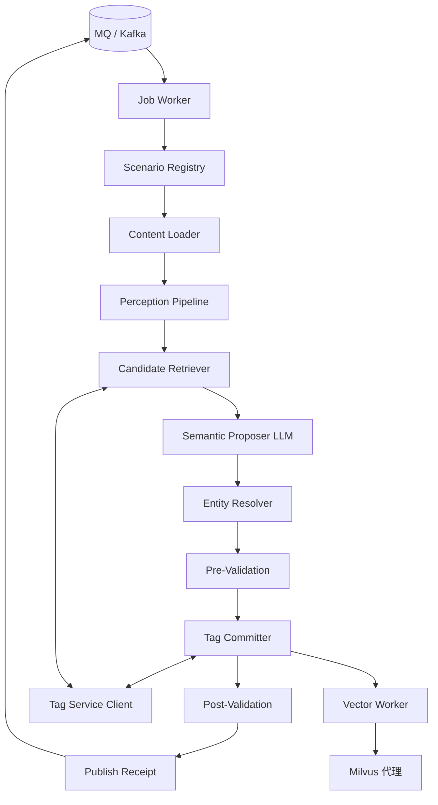

# AI Agent 实现详细设计

| 项目 | 内容 |
|------|------|
| 版本 | v0.5.0（MVP + 生产适配稿） |
| 状态 | S4 商品打标与服务端类目向量召回适配已实现；外部契约联调与生产模型验收待完成；产品行为以 [PRD](./PRD.md) 为准 |
| 更新日期 | 2026-09-02 |
| 上游依据 | [AI Agent 与推荐搜索系统架构设计](./agent_architecture.md)（v0.10.0）· [PRD](./PRD.md)（v0.6.0）· [需求缺陷与差距分析](./requirement_gap_analysis.md)（v0.4.0）· [Agent-商品打标](./Agent-商品打标.md) · [商品类目表](./在场电商平台商品分类信息.xlsx) · [AI Agent交互协议设计](../AI%20Agent交互协议设计.md) |
| 适用范围 | Agent 运行时的模块划分、数据契约、可靠性机制、场景管线与实施顺序 |

> **决策优先级**：产品行为和验收以需求基线（PRD、gap analysis）为准；`agent_architecture.md` 定义目标架构；本文档定义可执行的实现方案。三者冲突时，按“需求 > 架构 > 实现”解决，冲突项记录在 [第 0 节](#0-争议与待确认事项)。
>
> **状态标记说明**：本文档所有条款均带状态标签 —
> - `[已确认]`：已有明确结论，可直接实现；
> - `[暂定]`：有可执行默认方案，正式规则待冻结后可能调整，**实现必须做成可配置项，不得写死**；
> - `[待确认]`：尚无结论，本文档只给出设计占位与扩展点，不实现具体业务规则；
> - `[实现建议]`：纯工程可靠性方案，不涉及产品决策，可直接实现。

**v0.2.0 修订说明**：根据早期 S1/S2 补充需求（现以 [S1/S2 需求契约](./s1_s2_requirement_v2.md) 为准），S1 职业识别/S2 技能识别已从骨架占位（`schema_status="draft"`）升级为详细设计，见 [§5.3](#53-s1s2-职业技能识别详细设计)、[§3.3.3](#333-s1-careerrecognitionresult)、[§3.3.4](#334-s2-skillrecognitionresult)、[§6.4](#64-生成式候选与检索归一s1s2-专用)；新增争议项 D011～D014（见 §0）。

**后续修订（2026-08-10）**：关闭 D004——移除 S3 视频/音频 Feature Flag 接线与 `scene.s3.video.*` 配置面；视频/音频作为 S3 基线感知能力按媒体直接调度（§5.1.4）。

**v0.3.0 修订说明（2026-08-19）**：S4 正式定义为商品打标，历史用户画像建议不再占用 S4；新增 `ProductLabelResult`、商品类目快照导入、OCR+Vision、二级叶子混合召回、模型 A 分类 + 模型 B 独立复核、0.85 自动通过阈值、搜索词/候选分类建议边界与验收指标。S4 当前仅完成文档设计，尚未注册 Handler 或实现向量召回。

**v0.4.0 修订说明（2026-08-19）**：注册 S4 Handler 并落地 MVP 固定管线；A026/D006 状态映射已确认，合法 `need_review/unknown` 作为 `status=success` 的业务结果返回。当前类目工作簿使用确定性稳定 ID 与内容版本，LLM 类目知识离线富化/持久化仍待生产化。

**v0.5.0 修订说明（2026-09-02）**：明确生产类目知识、向量入库及版本发布由服务端
类目平台负责；LabelAgent 复用 `EmbeddingProvider` 与 `MilvusProxyClient`，按
`taxonomy_version` 从服务端类目向量集合召回二级候选。本地 xlsx 索引保留为 MVP 回退。

---

## 目录

0. [争议与待确认事项](#0-争议与待确认事项)
1. [设计目标与原则](#1-设计目标与原则)
2. [总体架构与模块划分](#2-总体架构与模块划分)
3. [核心数据契约](#3-核心数据契约)
4. [可靠性设计：直接消费 MQ](#4-可靠性设计直接消费-mq)
5. [场景管线详细设计](#5-场景管线详细设计)
6. [标签解析、创建与向量一致性](#6-标签解析创建与向量一致性)
7. [Validation 与规则引擎（分期设计）](#7-validation-与规则引擎分期设计)
8. [安全与隐私](#8-安全与隐私)
9. [可观测性与验收指标](#9-可观测性与验收指标)
10. [配置与扩展点一览](#10-配置与扩展点一览)
11. [实施顺序](#11-实施顺序)
12. [开放问题跟踪表](#12-开放问题跟踪表)

---

## 0. 争议与待确认事项

本节汇总会影响实现方式的争议点。**每一项都必须在代码中体现为配置项、版本号或可替换策略，而不是硬编码分支**，以便结论冻结后只改配置/策略实现，不改架构。

| 编号 | 关联编号 | 争议内容 | 当前文档状态 | 实现预留方案 |
|------|----------|----------|--------------|--------------|
| D001 | A004/Q016 | 规则引擎是否已定稿 | `agent_architecture.md`/PRD 称基线能力；gap analysis 称已撤出定稿，仅需 schema+在库校验 | 拆分 MVP Validation 与完整 RuleEngine 两层，后者按 `policy_version` 插件化加载，见 [§7](#7-validation-与规则引擎分期设计) |
| D002 | A006/Q005/Q015 | 标准标签与别名何者作为最终输出 | 三处表述不一致；Q015 已确认同簇只占 1 额 | 输出同时保留 `display_name` 与 `canonical_tag_id`，去重按簇；`name_type` 字段可切换默认展示策略，见 [§6.1](#61-输出与去重契约) |
| D004 | A001/C001 | 视频是否上线 | 架构稿已确认处理；PRD 曾提上线开关 | **已关闭**：不设独立 Feature Flag；视频/音频作为 S3 感知基线能力，存在对应媒体即调度，失败记入 `failed_modalities`/`degraded_modalities`，见 [§5.1.4](#514-视频与音频处理) |
| D005 | A020/C020 | 兜底类是否只提取 `service_mode` | **已确认**：非关系、非技能任务进入兜底类 | 当前沿用 `dessert` 编码，只输出 `service_mode`，不设扩展字段 |
| D006 | A026 | MQ 回执二值状态与 Job 四态映射 | **已确认** | 外层仅表达技术处理；有效业务结果映射 `success`，业务决策写入 `payload.decision`，见 [§4.4](#44-job-终态与对外回执映射) |
| D007 | A007/Q018 | Tag Service 是否独立部署 | gap analysis 定为 P0 必建；架构稿称部署形态未确定 | 只定义 `TagServiceClient` 接口，部署形态通过依赖注入切换，实现不感知是否独立服务 |
| D008 | Q003 | 商品/任务/日常业务域与十类一级分类的映射 | 待确认 | 分类字典按 `domain` 分区查询，映射表来自配置服务，不写入代码常量 |
| D009 | Q011 | S1/S2/S3 标签词库是否同库分域 | 建议同一 Tag Service 按 `domain` 隔离 | 所有标签检索/创建接口强制携带 `domain` 参数，见 [§6](#6-标签解析创建与向量一致性) |
| D010 | Q006 | 规则引擎未定稿期间人工审核门禁 | 有过渡建议，无正式冻结 | `ReviewRouter` 规则集独立配置，可随产品结论调整触发条件，不改动主流程代码 |
| D011 | 产品需求补充文档 | S1/S2 检索置信度保留阈值（原文“置信度评分>?”） | 产品需求补充文档明确存在阈值但未给出数值 | 配置项 `policy.retrieval_confidence.career`/`policy.retrieval_confidence.skill`，默认保守取值（宁可判定不相似、走生成兜底，不默认判定相似而误丢弃生成候选），见 [§5.3.1](#531-两场景共性设计与生成-检索归一) |
| D012 | 产品需求补充文档 | “语义比对（相似/关联判定）”算法未指定 | 产品需求补充文档只描述行为（相似则合并、不相似则保留），未指定算法 | 实现建议复用候选检索阶段的向量相似度分数作为比对依据，不做二次 LLM 判断；封装为可替换的 `SemanticReconciliationPolicy`，见 [§5.3.4](#534-共享组件generativecandidatereconciler生成式候选归一组件) |
| D013 | 产品需求补充文档 | “不相似的生成职业/技能”是否需要落库为正式词条 | 产品需求补充文档只描述返回行为，未提及是否入库 | 默认复用 §6.2 创建安全门禁流程写入 `domain=career`/`domain=skill`（与 D009 一致），可通过 `scene.s1.auto_create_unmatched`/`scene.s2.auto_create_unmatched` 关闭为“仅返回不入库”，见 [§6.4](#64-生成式候选与检索归一s1s2-专用) |
| D014 | 产品需求补充文档 | 职业“结构化职业描述数据”字段清单未定 | 产品需求补充文档只提到“相关的结构化职业描述数据”，未列字段 | 沿用 §5.2.3 甜品类同款模式：输出保留 `structured_fields: {}` 扩展位，产品补充字段后只需填充值，不改变 Schema 版本号，见 [§3.3.3](#333-s1-careerrecognitionresult) |

**实现约束**：只要某条款带 `[暂定]`/`[待确认]`，对应实现必须满足——

1. 有明确的配置项或策略接口，改变结论不需要改代码结构；
2. 有默认安全值（宁可保守拒绝/转人工，不默认放行）；
3. 在日志与结果中记录所用的策略版本号，便于回溯。

---

## 1. 设计目标与原则

1. **异步语义生产者** `[已确认]`：Agent 只消费 MQ 触发的任务，不参与在线搜索/推荐调用链路。
2. **场景路由而非通用 Agent 循环** `[已确认]`：不采用开放式 ReAct/多步自主规划；Router 按场景选择固定管线，保证可预测性和可审计性。
3. **模型提议与系统决策分离** `[实现建议]`：LLM 只输出语义候选（`SemanticProposal`），不直接产生标签 ID、不执行写操作、不决定最终阈值。
4. **写操作前置校验** `[实现建议]`：任何对 Tag Service / Milvus / 结果发布的写入，必须先通过 Schema、证据、安全门禁校验，禁止“先创建再校验”。
5. **配置驱动而非分支硬编码** `[实现建议]`：所有 `[暂定]`/`[待确认]` 规则通过配置中心或策略注册表接入。
6. **至少一次投递 + 幂等副作用** `[实现建议]`：不追求端到端 Exactly-Once；Kafka 至少一次投递 + 业务版本号解决重复与乱序，任务不落本地库。
7. **分类只读、标签可建** `[已确认]`：分类库任何实现路径都不得提供创建接口；标签创建必须经统一 Tag Service。

---

## 2. 总体架构与模块划分

### 2.1 运行时数据流



### 2.2 建议代码结构（Python 3.10 + Poetry）

```text
src/label_agent/
  application/            # 编排层：Orchestrator、ProcessTask
  domain/                 # 领域模型、策略接口、无外部依赖
    models/
    policies/
    evidence/
    confidence/
  scenarios/              # 各场景 ScenarioHandler 实现
    s3_content/
    t1_task_detail/
    s1_career/            # 职业识别，功能详细设计见§5.3
    s2_skill/              # 技能识别，功能详细设计见§5.3
    s4_product/            # 商品打标，MVP 已实现，功能详细设计见§5.4
  perception/              # 文本/图片/视频/OCR/ASR
  retrieval/                # 候选召回与融合
  inference/                 # LLM Gateway、Prompt 版本管理
  resolution/                 # 实体解析、标签提交
  validation/                  # Schema/证据/安全/规则引擎
  embedding/                    # 标签向量
  infrastructure/                # MQ、TagService、ObjectStorage、MilvusProxy 适配器
  workers/                         # JobWorker、VectorWorker、ReconciliationWorker
  config/                            # 配置中心客户端、策略版本加载
```

约束：`domain/` 不依赖任何具体 SDK；场景实现只允许通过接口访问基础设施层，便于替换 Tag Service 部署形态（D007）而不改动业务代码。

### 2.3 场景注册机制

```python
class ScenarioHandler(Protocol):
    scene: str                      # S3 | T1 | S1 | S2 | S4
    def can_handle(self, envelope: TaskEnvelope) -> bool: ...
    async def run(self, ctx: JobContext) -> ScenarioResult: ...

class ScenarioRegistry:
    def register(self, handler: ScenarioHandler) -> None: ...
    def resolve(self, envelope: TaskEnvelope) -> ScenarioHandler: ...
```

新增场景或调整某场景的必经阶段，只需注册新的 `ScenarioHandler`，不改动 Consumer/ProcessTask。

---

## 3. 核心数据契约

### 3.1 MQ 投递信封

**v1（协议基线，`[已确认]`，当前必须兼容）**

| 字段 | 类型 | 说明 |
|------|------|------|
| `task_id` | string | 任务标识 |
| `task_type` | string | 协议类型，如 `mark_tag` |
| `payload_type` | string | 数据类型，如 `product`/`dynamic` |
| `payload` | object | 业务内容 |
| `priority` | int | 1/2/3 |
| `timestamp` | long | 投递时间 |
| `callback_topic` | string | 回执 Topic |

**v2（实现建议扩展，`[暂定]`，需协议评审，A026）**

在 `payload` 内携带以下字段，评审通过前作为**内部约定**，不视为协议正式字段：

```json
{
  "event_id": "evt-...",
  "biz_id": "dynamic-123",
  "data_version": 17,
  "scene": "S3",
  "resource_uris": ["..."],
  "payload_hash": "sha256:...",
  "trace_id": "trace-...",
  "biz_task_type": null
}
```

> 命名约束：`payload_type`/协议层 `task_type` 与 T1 的业务 `biz_task_type` 是不同层级字段，实现中禁止复用同一变量名，避免 `agent_architecture.md` §9.1 已指出的混淆问题。

适配层设计：`EnvelopeParser` 统一解析 v1 字段；v2 扩展字段通过 `payload.get(...)` 安全读取，缺失时使用降级默认值（如 `data_version` 缺失时视为“无版本保护”，记录告警，不阻断处理，但禁止用于覆盖判断）。协议冻结后只需替换 `EnvelopeParser` 实现。

### 3.2 回执（v1，`[已确认]`，实现唯一对外契约）

| 字段 | 类型 | 说明 |
|------|------|------|
| `task_id` | string | 关联任务 ID |
| `task_type` | string | 协议类型 |
| `payload_type` | string | 数据类型 |
| `status` | string | 仅 `success` / `fail` |
| `message` | string | 失败原因 |
| `payload` | object | 附加信息 |
| `process_time` | long | 处理耗时 |
| `timestamp` | long | 完成时间 |

**D006 实现方案**：Job 内部四态 `SUCCESS/PARTIAL_SUCCESS/NEED_REVIEW/FAILED` 不直接暴露，映射规则：

| Job outcome | 对外 `status` | 说明 |
|---|---|---|
| `SUCCEEDED` | `success` | 所有必需副作用已持久化（标签向量 `READY` 或不涉及新标签） |
| `NEED_REVIEW` | `success`，`payload.decision=need_review` | 技术处理已完成；`payload.need_manual_review=true`，不得触发 MQ 重投 |
| `PARTIAL_SUCCESS` | `success`，业务子状态放入 `payload` | 已产出可消费结果；消费方按 payload 决定后续业务动作 |
| `FAILED` | `fail` | 附 `retryable` 提示（暂定内部字段，见 §3.1 v2） |

`SUPERSEDED` 和未产出合法结构化结果的失败映射 `fail`。S4 的 `unknown/need_review` 正常返回结果并使 Job 为 `SUCCEEDED`，不依赖异常表示业务决策。

### 3.3 场景输出契约

#### 3.3.1 S3 `ContentLabelResult`

```json
{
  "schema_version": "1.0",
  "biz_id": "dynamic-123",
  "data_version": 17,
  "result_revision": 3,
  "dictionary_snapshot_version": "dict-2026-07-20",
  "model_run_id": "run-...",
  "prompt_version": "s3-v3",
  "policy_version": "rule-mvp-1",
  "primary_category": {
    "category_id": "cat-photo",
    "name": "摄影",
    "confidence": 0.92,
    "evidence_refs": []
  },
  "secondary_category": null,
  "tags": [
    {
      "tag_id": "tag-19",
      "canonical_tag_id": "tag-19",
      "display_name": "复古胶片风",
      "name_type": "standard",
      "source": "matched",
      "model_score": 0.86,
      "final_confidence": 0.84,
      "evidence_refs": [],
      "vector_state": "READY"
    }
  ],
  "degraded_modalities": [],
  "perception_versions": {}
}
```

约束：

- `secondary_category` 允许 `null`（二级字典未冻结，`[暂定]`）；
- `tags` 长度 0～5，按 `final_confidence` 降序，`[已确认]`；
- 每个标签必须带 `canonical_tag_id`，用于同簇去重（D002）；
- 新建标签的 `vector_state` 可为 `PENDING`；若结果发布前仍为 `PENDING`，按 §6.3 规则处理。

#### 3.3.2 T1 `TaskDetailResult`

| 字段 | 说明 | 状态 |
|------|------|------|
| `accept_mode` | `public`/`specified`，校验后透传 | 已确认 |
| `biz_task_type` | `relationship`/`skill`/`dessert` | 已确认；随 TaskDetailResult schema 版本管理 |
| `relation_target` | `person`/`other_object`/`null` | 已确认 |
| `relation_target_detail` | 描述 | 已确认 |
| `required_skills[]` | 技能类字段 | 已确认 |
| `service_mode` | `offline`/`non_offline`/`null` | 已确认 |
| `extraction_errors[]` | 结构化 code/field/message/retryable | 已确认 |

不含 `returned_user_id` 等指定人历史查询字段——该部分由业务后端在合并层追加，Agent 输出中不出现，修正此前设计与 PRD §7 描述不一致的问题。

#### 3.3.3 S1 `CareerRecognitionResult`

```json
{
  "schema_version": "1.0",
  "biz_id": "user-cert-123",
  "model_run_id": "run-...",
  "prompt_version": "s1-v1",
  "policy_version": "provisional-rule-mvp-1",
  "dictionary_snapshot_version": "dict-career-2026-07-27",
  "careers": [
    {
      "career_id": "career-88",
      "canonical_career_id": "career-88",
      "display_name": "Python工程师",
      "source": "matched",
      "model_score": 0.81,
      "final_confidence": 0.83,
      "structured_fields": {},
      "evidence_refs": [],
      "vector_state": "READY"
    },
    {
      "career_id": null,
      "canonical_career_id": null,
      "display_name": "嵌入式固件开发",
      "source": "generated_unmatched",
      "model_score": 0.74,
      "final_confidence": 0.74,
      "structured_fields": {},
      "evidence_refs": [],
      "vector_state": "PENDING"
    }
  ],
  "skill_tags": [
    {
      "tag_id": "tag-501",
      "canonical_tag_id": "tag-501",
      "display_name": "C语言",
      "source": "matched",
      "model_score": 0.88,
      "final_confidence": 0.86,
      "evidence_refs": [],
      "vector_state": "READY"
    }
  ],
  "degraded_modalities": [],
  "perception_versions": {}
}
```

约束（依据 [S1/S2 需求契约](./s1_s2_requirement_v2.md) 及历史补充流程 1，实现细节见 §5.3.2）：

- `careers` 长度 0～5（原文“最多5个”）；`source` 取值 `matched`（检索命中，语义比对后保留检索结果）或 `generated_unmatched`（生成候选未命中检索或相似度不足阈值，保留生成结果本身）；
- 组装优先级：`matched` 全部保留，`generated_unmatched` 按 `model_score` 降序补位，直至 `len(careers) = min(5, matched数 + unmatched数)`（原文示例：检索到 3 个则最多补 2 个不相似生成项）；
- 全部未检索到任何结果时，`careers` 直接为生成候选（`source` 全部为 `generated_unmatched`），长度 0～5；
- `structured_fields` 当前始终为 `{}` 占位（D014），产品补充字段后只需填充值，不改变 `schema_version`；
- `skill_tags` 长度 0～5，为“不相似的生成职业”的技能标签（原文），复用 §5.3.3 技能识别子流程产出，`domain=skill`；
- `career_id`/`canonical_career_id` 为 `null` 表示尚未创建为正式词条（取决于 D013 配置开关；开启时创建后由 `TagCommitter` 回填，`vector_state` 初始为 `PENDING`）。

#### 3.3.4 S2 `SkillRecognitionResult`

```json
{
  "schema_version": "1.0",
  "biz_id": "user-cert-124",
  "model_run_id": "run-...",
  "prompt_version": "s2-v1",
  "policy_version": "provisional-rule-mvp-1",
  "dictionary_snapshot_version": "dict-skill-2026-07-27",
  "skills": [
    {
      "tag_id": "tag-77",
      "canonical_tag_id": "tag-77",
      "display_name": "MySQL建表",
      "source": "matched",
      "model_score": 0.79,
      "final_confidence": 0.80,
      "evidence_refs": [],
      "vector_state": "READY"
    },
    {
      "tag_id": null,
      "canonical_tag_id": null,
      "display_name": "Redis集群运维",
      "source": "generated_unmatched",
      "model_score": 0.71,
      "final_confidence": 0.71,
      "evidence_refs": [],
      "vector_state": "PENDING"
    }
  ],
  "degraded_modalities": [],
  "perception_versions": {}
}
```

约束（依据 [S1/S2 需求契约](./s1_s2_requirement_v2.md) 及历史补充流程 2，实现细节见 §5.3.3）：

- `skills` 长度 0～5，组装优先级与去重规则与 S1 `careers` 相同（`matched` 全保留 + `generated_unmatched` 补位封顶 5）；
- 未检索到任何结果时，直接返回生成技能标签（`source` 全部为 `generated_unmatched`），长度 0～5；
- `tag_id`/`canonical_tag_id` 为 `null` 的处理与 S1 一致，取决于 D013。

#### 3.3.5 S4 `ProductLabelResult`

```json
{
  "schema_version": "1.0",
  "scene": "S4",
  "product_id": "product-123",
  "data_version": 1,
  "taxonomy_version": "s4-taxonomy-20260819-v1",
  "category": {
    "level1": {"category_id": "cat-l1-...", "name": "酒水饮料"},
    "level2": {"category_id": "cat-l2-...", "name": "啤酒"}
  },
  "confidence": 0.91,
  "decision": "classified",
  "need_manual_review": false,
  "reason_codes": [],
  "evidence_refs": [],
  "search_terms": {
    "core_terms": [],
    "attribute_terms": [],
    "scene_terms": [],
    "long_tail_queries": [],
    "synonym_terms": [],
    "feature_terms": []
  },
  "category_suggestion": null,
  "model_runs": {
    "classifier": {"model_alias": "s4_classifier", "prompt_version": "s4-classify-v1", "confidence": 0.93},
    "reviewer": {"model_alias": "s4_reviewer", "prompt_version": "s4-review-v1", "confidence": 0.91}
  },
  "degraded_modalities": [],
  "perception_versions": {}
}
```

约束：

- `decision` 为 `classified/unknown/need_review`；`unknown` 或 `need_review` 时 `category` 允许为 `null`；
- `category.level1` 必须由 `category.level2.parent_category_id` 解析得到，禁止独立生成；
- `confidence = min(classifier.confidence, reviewer.confidence)`，自动通过阈值固定为 0.85；
- `search_terms` 仅在 `decision=classified`、两模型一致、最终置信度达标且确定性校验通过时非空；
- `category_suggestion` 仅在判断为现有类目缺失时非空，Agent 不据此创建正式分类；
- `taxonomy_version`、两个模型/Prompt 版本和降级信息必填，用于审计与回放。

### 3.4 证据引用 `EvidenceRef`（实现建议，替代自由文本证据）

```text
文本：{ "type": "text", "asset_id", "char_start", "char_end", "quote", "content_hash" }
图片：{ "type": "image", "asset_id", "bbox", "ocr_span", "image_hash" }
视频：{ "type": "video_frame", "asset_id", "frame_id", "start_ms", "end_ms", "bbox" }
ASR ：{ "type": "asr", "asset_id", "start_ms", "end_ms", "quote" }
```

`evidence` 自由文本字段保留用于人工审核台展示，但**规则引擎判定证据真实性时只信任 `EvidenceRef` 校验结果**，不信任自由文本本身。

---

## 4. 可靠性设计：直接消费 MQ

任务不落本地业务库。`job_worker` 消费入站 Topic，执行场景管线，发布回执后再提交 Offset。

### 4.1 消费与 ACK

```text
1. JobWorker 收到消息，校验大小/来源/权限并解析信封
2. ProcessTask 执行 Orchestrator（进程内可重试）
3. 发布 callback_topic 回执（超限改为精简失败回执）
4. 成功后才 ACK / 提交 Offset
5. 解析失败或不可重试错误：写入 DLQ 后提交 Offset
6. 发布失败超过次数：回退 Offset，进程重启或下次 poll 再处理
```

**D006 关联约束**：v1 协议无 `event_id`/`biz_id`/`data_version`，实现必须做兼容降级：

- `event_id` 缺失 → 用 `task_id` 兜底，同时记录 `degraded_idempotency=true`；
- `biz_id`/`data_version` 缺失 → 无法做版本保护，记录告警指标，按“先到先处理、后到直接覆盖”降级策略处理，并在结果中标注 `version_protected=false`，供后续排查。

Kafka 至少一次投递下，同一 `event_id` 可能被执行多次；去重依赖 Tag Service 版本保护与上游按 `event_id`/`data_version` 消化回执，而不是本地 Inbox 表。

### 4.2 并发与分区

多实例互斥由 Kafka 分区所有权承担：同一分区同一时刻只有一个 Consumer。并行度 ≈ 分区数。

分区键建议：`payload_type + biz_id`，降低同一业务对象的乱序概率（不能替代版本校验）。

长任务会占用分区处理时间；可重试错误在进程内退避，避免把短暂失败立刻变成分区重平衡。

### 4.3 版本与乱序处理（依赖 `data_version`，`[暂定]`，见 4.1 降级说明）

| 情形 | 处理 |
|------|------|
| 版本 `< latest_seen` | 标记 `SUPERSEDED`，不调用模型 |
| 版本 `= latest_seen`，Hash 相同 | 视为重复消息，直接按已有结果 ACK |
| 版本 `= latest_seen`，Hash 不同 | 协议异常，进入隔离队列，不自动处理 |
| 版本 `> latest_seen` | 正常处理 |
| 处理中发现新版本到达 | 当前 Job 终止发布，标记 `SUPERSEDED` |

`data_version` 缺失时（v1 协议兜底路径）该表整体跳过，改为纯 FIFO 处理并输出告警指标。版本比较发生在 Tag Service / 业务侧，Agent 进程内不保存 `latest_seen`。

### 4.4 Job 终态与对外回执映射

```text
phase:            LOAD → PERCEIVE → RETRIEVE → PROPOSE → RESOLVE
                    → PRE_VALIDATE → COMMIT → VECTORIZE → POST_VALIDATE → PUBLISH
outcome:          SUCCEEDED / NEED_REVIEW / PARTIAL_SUCCESS / FAILED / SUPERSEDED
```

`phase` 描述管线阶段，不再作为本地库字段推进。`outcome` 只用于回执映射与日志，不提供 HTTP 进度查询。对外映射见 §3.2。

### 4.5 重试与 DLQ

| 类别 | 示例 | 处理 |
|------|------|------|
| 可重试 | MQ 短暂不可用、HTTP 超时/限流/5xx、Milvus 暂时不可用、乐观锁冲突 | 进程内指数退避，达到 `max_attempts` 后发失败回执并 ACK |
| 不可重试 | Schema 不兼容、缺失必填字段、非法媒体格式、同版本不同 Payload | 写入 DLQ 后 ACK |
| 业务待处理 | 证据不足、敏感候选命中、新标签安全门禁未通过 | `NEED_REVIEW`，进入审核队列 |

DLQ 记录：原始消息、`event_id`/`job_id`、错误码、失败时间、是否可重放。重放须复用原幂等键或建立 `replay_generation`，不得用新 `task_id` 绕过幂等键。

### 4.6 回执发布

Orchestrator 组装 `Receipt` 后由 `ProcessTask` 直接 `publish`。回执超过 900KB 改为精简失败回执；发布失败最多 5 次指数退避。下游按 `event_id`（或降级 `task_id`）+ `data_version` 去重，兼容重复发布。

### 4.7 对账与恢复（`[实现建议]`）

周期任务：

1. Consumer Group Lag / DLQ 积压告警；
2. 标签—向量一致性对账（见 §6.3）；
3. Agent 结果版本 / ES 版本对账。

---

## 5. 场景管线详细设计

### 5.1 S3 动态内容分类与标签

#### 5.1.1 阶段

```text
LOAD → PERCEPTION → CANDIDATE RETRIEVAL → SEMANTIC PROPOSAL(LLM)
  → ENTITY RESOLUTION → PRE-VALIDATION → TAG COMMIT
  → VECTORIZE(新标签) → POST-VALIDATION → PUBLISH
```

关键设计：**创建/写入操作只能发生在 PRE-VALIDATION 通过之后**，修正此前“先创建再校验”的顺序缺陷。

#### 5.1.2 感知（Perception）

`ContentBundle` 字段：`normalized_text`、`image_artifacts[]`、`video_frame_artifacts[]`、`ocr_segments[]`、`asr_segments[]`、`successful_modalities[]`、`failed_modalities[]`、`truncation_flags[]`、`content_hash`、`perception_versions`。不持久化，不等同于 `content_vector`（A008 已确认不建设）。

媒体处理硬约束（`[实现建议]`，与业务范围无关，必须实现）：

- MIME/magic bytes 双重校验；
- 大小/时长/分辨率上限；
- URI 域名白名单 + 私网地址阻断（防 SSRF）；
- 内容 Hash 去重；
- 模态失败必须记录到 `failed_modalities`，不得静默跳过。

##### S1/S2 感知实现（Router + Extractors）

S1/S2 **不**直接依赖尚未落地的 S3 `ContentBundleBuilder`（OCR/视频/ASR）。当前实现为轻量编排：

```text
payload
  → InputRouter（兼容 text/image_path/input_path + 推荐 attachments[]）
  → Extractors（text / image_vision / pdf / docx / doc）
  → TextNormalizer 合并规整
  → ContentBundle
```

| 组件 | 职责 |
|------|------|
| `perception/input_router.py` | 异构 payload → 有序 `AttachmentRef` |
| `perception/extractors/*` | 按类型抽取为 `ExtractionResult` |
| `perception/certificate_content_loader.py` | 调度、聚合、产出 `ContentBundle` |

格式策略：

| 输入 | 策略 | `successful_modalities` 示例 |
|------|------|------------------------------|
| 纯文本 | `TextExtractor` + `TextNormalizer` | `text` |
| 图片 | `ImageVisionExtractor`（vision Prompt，只描述不做分类） | `image` |
| PDF（数字） | PyMuPDF 抽文本层 | `pdf_text` |
| PDF（扫描） | 文本过短则渲染前 N 页 → 视觉理解 | `pdf_vision` |
| DOCX | python-docx 抽段落/表格 | `docx` |
| DOC | 伪 DOCX（ZIP）委托 DOCX；原生 OLE 记失败并提示转码 | 成功时 `doc`，否则 `failed_modalities` 含 `doc` |

下游 `GenerativeProposer` **只消费** `ContentBundle.normalized_text`；`image_artifacts` / `failed_modalities` / `perception_versions` 用于溯源与结果契约回填。视频/ASR 字段在 S1/S2 路径保持空列表，留给 S3 `ContentBundleBuilder`。

#### 5.1.3 候选召回

并行召回：归一化精确匹配、别名匹配、n-gram/BM25、向量近义检索；按 `domain`（D009）、`scene`、`status`、`category` 过滤；多路结果用 RRF 融合。候选携带 `tag_id`/`canonical_tag_id`/`dictionary_snapshot_version`；模型只能引用候选 ID，不得自行生成 ID。

召回失败或候选为空时，允许提出 `new_tag_requested`，进入实体解析层判断是否满足创建条件（见 §6.2）。

#### 5.1.4 视频与音频处理

视频抽帧（`VideoFrameSampler`）与 ASR（`AsrTranscriber`）由 `ContentBundleBuilder` 在输入含对应媒体时直接调度，**不设** `scene.s3.video.*` Feature Flag 或单独上线开关（D004 已关闭）。

抽帧器内部可使用实现级默认上限（如时长/帧数），属于实现细节，不进入配置中心策略面。任一模态失败必须写入 `failed_modalities` / `degraded_modalities`，不得静默整单跳过（呼应 gap analysis Q002）。

#### 5.1.5 语义提议、实体解析、校验

对应 §3.3.1 的 `SemanticProposal` → `EntityResolver`（纯函数，无副作用）→ `PreValidation`（整单执行模态完整性、证据引用和新标签同步安全校验）→ `TagCommitter`（只负责查重、幂等创建和结果组装，是唯一允许写 Tag Service 的组件）。详见 §6。

### 5.2 T1 任务分支信息提取

#### 5.2.1 边界

后端负责 `accept_mode` 分流、历史指定人查询与派单；T1 Agent 根据文本和图片自行判断 relationship/skill/dessert 固定三分支，再做 §3.3.2 字段提取。Agent 不查订单库、不判定 userID、不复用 S3 的标签与置信度规则（已确认）。

`accept_mode` 只能是 `public` 或 `specified`；缺失、空值、大小写变体和其他值均在感知及 LLM 调用前返回不可重试错误 `T1_INVALID_ACCEPT_MODE`。

首版只支持文本与图片；图片信息与描述或正文冲突时，以描述和正文为准。

#### 5.2.2 分支提取器

```python
class TaskDetailExtractor(Protocol):
    biz_task_type: str  # relationship | skill | dessert
    async def extract(self, ctx: JobContext) -> TaskDetailResult: ...

class ExtractorRegistry:
    def resolve(self, biz_task_type: str) -> TaskDetailExtractor: ...
```

三分支由 Agent 内部判断后交给 ExtractorRegistry。正式输出字段使用 `biz_task_type`，schema 1.0 固定 `relationship/skill/dessert`；不对外提供 `task_type_registry_version`，编码变化通过 TaskDetailResult schema 升级管理（A025 已关闭）。

#### 5.2.3 兜底类

非关系类、非技能类任务统一进入兜底类；当前沿用 `dessert` 编码，只提取 `service_mode`，不设 `extended_fields`。

### 5.3 S1/S2 职业/技能识别详细设计

依据 [S1/S2 需求契约](./s1_s2_requirement_v2.md)，S1/S2 已有明确业务流程，本节替代此前的占位骨架设计。

#### 5.3.1 两场景共性设计与“生成-检索归一”

S1/S2 与 S3 的关键差异：S3 是“先检索候选、模型只能在候选内选择”（§5.1.3，模型不得自造 ID）；S1/S2 是**“模型先自由生成、再检索比对归一”**——因为职业/技能的开放程度高，不适合像分类字典一样提前收窄为固定候选集。两种模式并不冲突设计原则 3（模型提议与系统决策分离，见 §1）：S1/S2 的模型依然只产出候选（`SemanticProposal` 的职业/技能变体），不产生最终 ID、不执行写操作、不决定阈值——归一与写入仍在系统侧（`GenerativeCandidateReconciler` + `TagCommitter`）完成。

阶段（S1、S2 共用管线骨架，仅 `domain` 与感知重点不同）：

```text
LOAD → PERCEPTION(InputRouter + Extractors → ContentBundle.normalized_text)
  → GENERATIVE PROPOSAL(LLM，自由生成候选，最多5个，不受候选库约束)
  → CANDIDATE RETRIEVAL(对每个生成候选在职业/技能向量库按 domain=career|skill 检索 Top-1)
  → CONFIDENCE FILTER(检索分数 < policy.retrieval_confidence.{career|skill} 则丢弃该检索结果，D011)
  → SEMANTIC RECONCILIATION(生成 vs 检索归一：命中→保留检索、丢弃生成；未命中→保留生成，D012)
  → RESULT COMPOSITION(matched 全保留 + generated_unmatched 按分数补位，封顶 5)
  → PRE-VALIDATION(Schema/证据/安全门禁，同 §6.2)
  → TAG COMMIT(仅对 generated_unmatched 且判定入库的项创建，D013；matched 项复用已有 tag_id/career_id)
  → VECTORIZE(新建词条) → POST-VALIDATION → PUBLISH
```

关键约束：

- **生成先于检索**是 S1/S2 的专属管线形态，通过各自 `ScenarioHandler`/`pipeline.py` 实现，不影响 S3 既有的候选约束模式，两者通过 `ScenarioHandler` 注册表并存（§2.3）；
- 检索置信度阈值（D011）与语义比对算法（D012）均为独立配置项/策略接口，禁止写死；
- “生成先于检索”不改变写操作前置校验原则（§1 原则 4）：`TAG COMMIT` 仍在 `PRE-VALIDATION` 通过之后才发生。

#### 5.3.2 S1 职业识别

输入：图片或文本文档。抽取要素：职业信息、岗位、技能、公司等关键要素（原文）。

流程细节：

1. **感知**：经 §5.1.2「S1/S2 感知实现」将文本/图片/PDF/DOCX 等收敛为 `ContentBundle`（`domain` 无关，感知层不区分场景）；
2. **生成式提议**：LLM 基于感知文本一次性产出最多 5 个职业候选，每个候选附带“相关的结构化职业描述数据”（`structured_fields`，字段清单未定，见 D014）以及独立的技能要素抽取（用于后续 `skill_tags`，复用 §5.3.3 的技能识别子流程，`domain=skill`）；
3. **候选检索与置信度过滤**：对每个生成的职业候选，在职业向量库（`domain=career`）检索 Top-1，按 `policy.retrieval_confidence.career` 过滤（D011）；
4. **语义归一**：检索分数达标 → 判定为“相似/关联”，保留检索到的标准职业（`source="matched"`），丢弃对应的生成候选；检索缺失或分数不达标 → 保留生成候选本身（`source="generated_unmatched"`）；
5. **结果组装**：`matched` 全部保留；`generated_unmatched` 按 `model_score` 降序补位，总数封顶 5（原文示例：检索到 3 个则最多补 2 个不相似生成项）；若全部未检索到任何结果，直接返回全部生成职业（≤5 个）；
6. **技能标签**：对最终保留的 `generated_unmatched` 职业提取技能标签，最多 5 个（原文），走 §5.3.3 同款技能识别子流程（生成 → 检索 → 归一），不重复实现；
7. **校验与提交**：同 §5.3.1 通用阶段。

输出契约：见 [§3.3.3 `CareerRecognitionResult`](#333-s1-careerrecognitionresult)。

#### 5.3.3 S2 技能识别

输入：图片或文本文档。抽取要素：技能信息、掌握的工具等（原文）。

流程细节：

1. **感知**：同 S1，复用 §5.1.2「S1/S2 感知实现」；
2. **生成式提议**：LLM 基于感知文本产出最多 5 个技能标签候选；
3. **候选检索与置信度过滤**：对每个生成的技能候选，在技能向量库（`domain=skill`）检索 Top-1，按 `policy.retrieval_confidence.skill` 过滤（D011）；
4. **语义归一**：规则与 S1 一致（相似则保留检索标准技能、丢弃生成；不相似则保留生成）；
5. **结果组装**：`matched` 全部保留 + `generated_unmatched` 补位封顶 5（原文示例：检索到 3 个则最多补 2 个不相似生成技能）；全部未检索到时直接返回全部生成技能标签（≤5 个）；
6. **校验与提交**：同 §5.3.1 通用阶段。

输出契约：见 [§3.3.4 `SkillRecognitionResult`](#334-s2-skillrecognitionresult)。

> S1 的技能标签抽取（第 6 步）与 S2 的主流程复用同一实现（相同的“生成→检索→归一”子流程，仅调用入口不同），避免重复实现两套技能识别逻辑，符合高内聚低耦合原则。

#### 5.3.4 共享组件：`GenerativeCandidateReconciler`（生成式候选归一组件）

```python
class SemanticReconciliationPolicy(Protocol):
    policy_version: str
    def is_match(self, generated_score: float, retrieval_score: float) -> bool: ...
    # 默认实现直接复用向量检索阶段返回的相似度分数（D012），不做二次 LLM 判断

class GenerativeCandidateReconciler:
    def __init__(
        self,
        domain: str,                          # "career" | "skill"
        retrieval_confidence_threshold: float,  # D011，来自配置中心
        reconciliation_policy: SemanticReconciliationPolicy,
        max_output: int = 5,
    ) -> None: ...

    async def reconcile(self, generated_candidates: list[GeneratedCandidate]) -> list[ReconciledItem]:
        """
        对每个生成候选：
        1. 按 domain 检索 Top-1；
        2. 检索分数 < retrieval_confidence_threshold -> 视为未检索到，标记 generated_unmatched；
        3. 否则用 reconciliation_policy 判定是否相似 -> 相似则标记 matched(检索结果)，
           不相似则仍标记 generated_unmatched（各自保留原始生成候选）；
        4. 组装：matched 全部保留，generated_unmatched 按 model_score 降序补位，
           总数不超过 max_output。
        """
        ...
```

放置位置：`resolution/`（贴近 `EntityResolver`，同属“候选归一化为最终结果”职责），S1/S2 的 `ScenarioHandler`/`pipeline.py` 直接调用，S3 不受影响（S3 继续使用 `EntityResolver` 的候选约束式归并，见 §6.1）。

### 5.4 S4 商品打标详细设计

#### 5.4.1 类目快照导入

本地 MVP 输入工作簿 [在场电商平台商品分类信息.xlsx](./在场电商平台商品分类信息.xlsx)
只有一级、二级名称。`ProductTaxonomyImporter` 负责：

1. 读取并校验两列名称，拒绝空值和重复完整路径；
2. 首次导入时为一级和二级类目分配稳定内部 ID，并持久化名称—ID 映射；后续不能在每个 Job 中重新计算 ID；
3. 为二级类目写入唯一 `parent_category_id`；
4. 为整个本地快照生成 `taxonomy_version`、内容摘要和生效状态；
5. 处理跨父级同名二级类目和父子同名路径，所有索引键以 ID/完整路径为准；

当前快照统计：41 个一级类目、259 条路径、257 个不同二级名称；`办公家具`、`手机配件` 跨一级重名，`宠物用品/宠物用品` 父子同名。

生产环境不读取该工作簿。类目描述、正反例、关键词、相似类目与分类规则的生成、
机器门禁、向量入库及版本发布/回滚由服务端类目平台负责。LabelAgent 使用
`ProductCategoryVectorRetriever` 调用通用 `EmbeddingProvider` 和
`MilvusProxyClient.search()`，按 `level=2`、`status=active` 与
`taxonomy_version` 过滤，并将向量命中的 metadata 还原为 `ProductCategoryCandidate`。

#### 5.4.2 输入与感知

推荐 payload：

```json
{
  "product_id": "product-123",
  "title": "可选标题",
  "images": ["uri-or-data-ref"],
  "data_version": 1
}
```

- `title` 可空，`images` 长度 0～5，但二者不得同时为空；
- MIME/magic bytes 校验后原生处理 JPEG/PNG/WebP/GIF 首帧，其他格式先转码；
- 每张图片并行 OCR + Vision，聚合品牌、型号、规格、包装、主体和场景；
- 标题优先级高于图片结论，但冲突必须记录 `modality_conflict` 并进入审核；
- 不区分主图/详情图；内容 Hash 去重后仍保留原始 asset 引用供证据定位。

#### 5.4.3 召回与双模型决策

```text
LOAD → PRODUCT PERCEPTION(OCR+Vision)
  → QUERY FEATURE BUILD
  → LEVEL2 RETRIEVAL(exact/alias/BM25/vector, RRF Top20)
  → CLASSIFIER MODEL A(level2_id | unknown)
  → PARENT RESOLVER(level2.parent_id → level1)
  → REVIEWER MODEL B(pass/correct/unknown)
  → PRODUCT VALIDATOR
  → SEARCH TERM GENERATOR 或 CATEGORY SUGGESTION
  → PUBLISH ProductLabelResult
```

模型 A/B 使用不同模型或不同模型系列。模型 B 可看到商品画像、候选集合和待审核类目，但不得看到模型 A 的置信度和详细理由。只有两模型选择同一二级类目、两者分数均达标、父子关系和机器规则全部通过时自动分类。

`ProductValidator` 至少校验：候选 ID 存在、类目层级、父子关系、`taxonomy_version` 一致、包含/排除规则、标题/图片冲突、模态降级和严格 JSON Schema。最终分数取两模型较小值，阈值由 `policy.s4.auto_pass_threshold=0.85` 配置加载。

#### 5.4.4 搜索词、候选分类与发布

- 自动分类通过后调用商品搜索词生成器，结果仍需 Schema、商品事实溯源、去重、禁词和虚假属性校验；
- Agent 只在 `ProductLabelResult`/结果事件中发布搜索词，搜索中台是索引写入方；
- unknown/待审核结果先区分信息不足、边界不清、类目缺失；只有类目缺失时返回 `category_suggestion`；
- S4 不调用任何正式类目创建接口，不实现审核结果回流。

---

## 6. 标签解析、创建与向量一致性

### 6.1 输出与去重契约

`EntityResolver` 按 `canonical_tag_id` 归并候选：同一簇（标准标签+其别名）只保留 `final_confidence` 最高的一条，计入 5 额度中的 1 个（Q015 已确认）。`name_type` 字段区分 `standard`/`alias`，默认展示策略可配置（D002），当前默认输出模型选中的名称原样返回。

### 6.2 创建安全门禁（新标签，实现建议，独立于是否立即生效的产品决策）

Q017 已确认新标签创建后**立即进入正式词表**；这不等于可以跳过安全校验。创建前必须通过：

1. 标准名/别名/向量近义查重（避免重复创建）；
2. 归一化名称唯一约束 + 幂等键（`tenant_id + domain + normalized_name + dictionary_generation`）；
3. 敏感词、PII、辱骂、广告词检测；
4. `domain` 白名单校验；
5. 创建频率限额与异常熔断（单任务/租户级）。

并发创建冲突后回读已有标签，不重复创建（已确认要求）。

当前实现将名称规范、`domain` 白名单、敏感词、PII 和注入检测集中在
`validation/new_tag_safety.py`，由 `PreValidator` 在整单写入前统一调用；
依赖 Tag Service 的查重及幂等创建保留在 `TagCommitter`，避免校验失败时产生部分写入。

### 6.3 标签生命周期与向量一致性

将“正式生效”和“可参与召回”拆成两个正交状态，既满足“立即生效”要求，又避免无向量标签进入 ANN：

```text
lifecycle_status: ACTIVE / DISABLED / MERGED   # 词表可见性，创建后立即 ACTIVE
vector_state:     PENDING / READY / FAILED     # 向量是否可用于召回
```

流程：

1. `TagCommitter` 调用 Tag Service 原子创建标签，返回 `ACTIVE + PENDING`；
2. Tag Service 发出 `TagCreated` 事件；
3. `VectorWorker` 消费事件，生成向量并按 `tag_id + tag_definition_version + embedding_space_id` upsert 到 Milvus 代理；
4. 写入成功后回写 `vector_state=READY`；
5. `POST-VALIDATION` 检查本次结果引用的新建标签 `vector_state`：若仍为
   `PENDING`，Job 进入 `RETRY_WAIT`，在向量就绪前不发布 `TaggingCompleted`；
   超过最大重试次数才按 `FAILED` 收口，避免不可召回标签提前流入搜索/推荐。

当前实现已接通该异步链路：

- `TagCreated` 事件包含 `event_id`、`tag_id`、`tag_definition_version` 与
  `embedding_space_id`；Kafka Consumer 关闭自动提交，仅在处理成功或确认事件过期后提交
  Offset，短暂故障会回退游标重试；
- `TagVectorizer` 调用统一 `EmbeddingProvider`，并通过 `MilvusProxyClient`
  `/v1/vectors/upsert` 幂等写入 `tag_vectors`；
- `TagServiceClient.update_vector_state` 使用 `expected_definition_version` 做条件更新，
  防止旧事件把新版标签错误标记为 `READY`；
- S3 的向量待就绪异常继承 `RetryableError`，由 `JobWorker` 进入指数退避重试；
- `ReconciliationWorker` 周期扫描 `PENDING` 标签并补偿向量化，覆盖事件丢失或
  Consumer 长时间不可用场景。

生产依赖契约：

1. Tag Service 必须在标签创建事务提交后可靠发布 `tag.created`；
2. Tag Service 提供 `GET /v1/tags/{tag_id}`、
   `PATCH /v1/tags/{tag_id}/vector-state` 和
   `GET /v1/tags?vector_state=PENDING&limit=N`；
3. Milvus 代理提供 `POST /v1/vectors/upsert`，以复合向量 ID 保证重复消费幂等；
4. 部署必须设置 `MQ_BACKEND=kafka`、`VECTOR_EVENT_TOPIC`、
   `VECTOR_CONSUMER_GROUP`、`TAG_SERVICE_BASE_URL` 与 `MILVUS_PROXY_BASE_URL`。

此设计不违反“新标签立即生效”的产品结论——标签在词表和当前打标结果中已可见，只是搜索召回意义上的可见性由 `vector_state` 单独把关，且默认目标是尽快达成 `READY`，不是长期阻塞。

### 6.4 生成式候选与检索归一（S1/S2 专用）

§6.1～6.3 描述的是 S3 的“候选约束式”归并（模型只能在检索候选内选择）。S1/S2 采用相反顺序的“生成式”归并（§5.3.1），本节补充其与标签创建/向量一致性的衔接：

1. **检索**：`GenerativeCandidateReconciler`（§5.3.4）对每个生成候选在 `domain=career`/`domain=skill` 检索 Top-1，复用 §5.1.3 的向量近义检索能力，检索分数即语义相似度依据（D012）；
2. **归一**：命中且分数达标（D011）→ 判定为 `matched`，直接复用检索到的 `career_id`/`tag_id`（已 `ACTIVE`，`vector_state` 视已有词条状态而定，通常已 `READY`）；未命中 → 判定为 `generated_unmatched`，携带原始生成的 `display_name`（此时 `career_id`/`tag_id` 为 `null`）；
3. **是否创建为正式词条（D013）**：由 `scene.s1.auto_create_unmatched`/`scene.s2.auto_create_unmatched` 决定：
   - 开启（默认）：最终保留的 `generated_unmatched` 项进入 `TagCommitter`，按 §6.2 安全门禁（查重/敏感词/PII/`domain` 白名单/频率限额）创建，`domain` 分别为 `career`/`skill`；创建成功后 `lifecycle_status=ACTIVE`、`vector_state=PENDING`，走 §6.3 标准向量化流程回填 `READY`；
   - 关闭：`generated_unmatched` 项只在本次结果中原样返回，不落库、不参与 `POST-VALIDATION` 的 `vector_state` 检查（因为本来就不是标签库条目）；
4. **一致性收敛**：开启创建时，未来同一（或语义相近的）职业/技能再次被生成，会因词条已入库而在步骤 1 命中检索，逐步减少重复生成——这是本设计推荐默认开启 D013 的主要理由，但仍需产品确认后转为 `[已确认]`。

---

## 7. Validation 与规则引擎（分期设计）

### 7.1 MVP Validation（`[实现建议]`，可立即实现）

1. JSON Schema 校验（`additionalProperties:false`、枚举、长度、分数范围）；
2. 分类/标签 ID 合法性与在库状态校验；
3. `EvidenceRef` 可回查校验（引用存在、未越界、内容 Hash 一致）；
4. 按 `canonical_tag_id` 去重（Q015）；
5. 新标签命名规范、敏感词/PII/注入检测（§6.2）；
6. 模态缺失/失败记录完整性检查。

### 7.2 完整规则引擎（`[暂定]`，D001，按 `policy_version` 插件化）

```python
class ConfidencePolicy(Protocol):
    policy_version: str
    def score(self, proposal: SemanticProposal, evidence: EvidenceBundle) -> FinalConfidence: ...
```

默认候选公式（沿用架构稿，标记为候选而非定稿）：

```text
Final_Conf = calibrated_model_score
             × min(evidence_factor, consistency_factor, stability_factor)
```

要求：

- 系数与阈值通过配置中心加载，禁止写入代码常量；
- 保留原始模型分数与各系数，不在计算中提前舍入；
- 产品冻结规则前，使用 `provisional_policy_version` 标记结果，明确该结果不代表最终验收口径；
- 支持策略版本回放，便于规则变更后重新评估历史 Job。

### 7.3 人工审核路由（D010，`[暂定]`）

`ReviewRouter` 规则集独立配置，当前默认触发条件（可随产品结论调整，不改动主流程）：

- 无法解析 / JSON 不合规；
- 分类不在库；
- 新标签创建候选未通过安全门禁；
- 证据引用校验失败；
- 视频/图片解析部分失败且影响最终分类。

---

## 8. 安全与隐私

- 消息来源鉴权、防重放；`callback_topic` 采用服务端白名单路由，不接受消息内任意指定（呼应架构稿 §9 建议）；
- 所有业务文本/OCR/ASR 内容视为不可信数据，不能改变系统 Prompt 或触发工具调用；
- LLM Gateway 无 Tag Service / MQ / Milvus 写权限，写操作全部在 `TagCommitter` 完成，回执由 ProcessTask 直接发布；
- 媒体 URI 访问执行 SSRF 防护（域名白名单、私网阻断、重定向限制）；
- 认证材料加密存储、短期保留、访问审计；日志不记录完整证件、原文或长期媒体 URL；
- Milvus 只通过代理访问。

---

## 9. 可观测性与验收指标

### 9.1 技术指标（`[实现建议]`，实现即需采集）

队列等待与各 `phase` 耗时、模态成功率/降级率、JSON Schema 合规率、候选 `Recall@K`、词库命中率、`final_confidence` 分布、标签向量写入成功率（`vector_state` 分布）、E2E 到 ES 生效延迟、Token/模型/视频处理成本、DLQ 积压量、`version_protected=false` 事件占比（衡量 v1 协议降级影响面）；S1/S2 专属：生成候选命中检索率、`generated_unmatched` 占比与检索置信度分布；S4 专属：二级 `Recall@20`、模型 A/B 一致率、OCR/Vision 成功率、模态冲突率、unknown/审核/分类建议率、两个模型调用时延与成本。

### 9.2 业务指标（`[待确认]` 具体阈值，指标本身可实现采集）

分类准确率、标签 Precision/Recall/F1、T1 各分支提取准确率、新标签重复率/撤回率、人工审核率、注入攻击拦截率。S4 已确认首期目标：二级 `Recall@20 >= 98%`、一级准确率 `>=98%`、二级整体准确率 `>=95%`、自动通过准确率 `>=98%`、unknown 错误自动分类率 `<2%`、输出 Schema 合法率 `100%`；P95 时延与成本绝对阈值待压测冻结。

---

## 10. 配置与扩展点一览

| 配置项 | 用途 | 关联争议 |
|--------|------|----------|
| `protocol.version` | 切换 v1/v2 信封解析器 | D006/A026 |
| `tag.domain.mapping` | 分类/标签域映射 | D008/D009 |
| `policy.confidence.version` | 规则引擎系数版本 | D001 |
| `policy.review_router.version` | 人工审核触发规则 | D010 |
| `tag.name_type.default_display` | 标准/别名默认展示策略 | D002 |
| `tag_service.deployment_mode` | 独立服务 or 模块内嵌，仅影响依赖注入 | D007 |
| `policy.retrieval_confidence.career`/`.skill` | S1/S2 检索置信度保留阈值 | D011 |
| `policy.semantic_reconciliation.version` | S1/S2 生成-检索语义比对策略版本 | D012 |
| `scene.s1.auto_create_unmatched`/`scene.s2.auto_create_unmatched` | 不相似生成项是否落库为正式词条 | D013 |
| `scene.s4.max_images` | S4 图片数量上限，默认 5 | A027 |
| `retrieval.s4.top_k` | 二级叶子混合召回数量，默认 20 | A027 |
| `policy.s4.auto_pass_threshold` | 双模型自动通过阈值，固定基线 0.85 | A027 |
| `inference.s4.classifier_alias`/`reviewer_alias` | 模型 A/B 独立配置，禁止解析为同一模型绑定 | A027 |
| `taxonomy.s4.version` | 当前 S4 类目快照版本 | A027 |

所有上述配置变更均不应要求修改核心管线代码，只影响策略/适配器实现的加载。

---

## 11. 实施顺序

| 顺序 | 内容 | 前置 |
|------|------|------|
| 1 | Kafka/Mock 入站消费 + v1 协议兼容解析 + 直接执行/回执 | 无 |
| 2 | Tag Service Client 接口 + Mock 实现 | D007 接口冻结 |
| 3 | S3 文字/图片管线（含 MVP Validation） | 一级分类字典、EvidenceRef 校验规则 |
| 4 | 标签创建安全门禁 + 向量一致性状态机 | 向量协议 |
| 5 | T1 自动三分支判断、文本/图片感知与分支提取器 | — |
| 6 | 视频/音频感知实现 | — |
| 7 | S4 类目导入、稳定 ID、知识生成与机器门禁 | 商品类目表、类目映射持久化 |
| 8 | S4 OCR+Vision、二级混合召回、模型 A/B、`ProductLabelResult` | 两个独立模型绑定、S4 金标集 |
| 9 | 完整规则引擎插件化接入 | D001 产品冻结 |
| 10 | S1/S2 正式实现（功能设计已冻结，见 §5.3）接入生产路由 | D011/D012/D013 阈值与创建策略确认 |

---

## 12. 开放问题跟踪表

| 编号 | 状态 | 阻塞范围 | 下一步 |
|------|------|----------|--------|
| D001 | 待确认 | 完整规则引擎上线 | 产品/算法冻结系数与人工审核阈值（Q016） |
| D002 | 待确认 | 标签展示与索引归一 | 产品确认标准/别名展示口径（Q005 索引侧） |
| D004 | 已关闭 | — | 不设 Feature Flag；视频/音频按 A001 纳入 S3 基线感知 |
| D005 | 已关闭 | — | 兜底类仅提取服务方式，不设扩展字段 |
| D006 | 已关闭 | 回执状态表达能力 | 外层技术状态 + `payload.decision` 已确认并实现 |
| D007 | 待评审 | Tag Service 部署形态 | 架构评审，接口先行不受影响 |
| D008 | 待确认 | 分类字典结构 | 产品确认业务域映射（Q003） |
| D009 | 待确认 | 标签词库隔离方式 | 产品/架构确认（Q011） |
| D010 | 待确认 | 人工审核门禁 | 产品确认过渡期规则（Q006） |
| D011 | 待确认 | S1/S2 检索保留是否合理（阈值过高/过低） | 产品/算法冻结 `policy.retrieval_confidence.career`/`.skill` 数值 |
| D012 | 待确认 | S1/S2 相似判定是否需要比向量分数更复杂的比对 | 产品/算法评估“复用检索分数”简化方案是否满足业务预期 |
| D013 | 待确认 | S1/S2 生成兜底项能否落库为正式词条 | 产品确认是否接受职业/技能词库因生成结果自动扩张 |
| D014 | 待确认 | 职业结构化描述字段清单 | 产品补充 `structured_fields` 具体字段（公司、岗位级别等） |
| D015 | 已关闭 | S4 场景编号与商品规则 | S4 已确认为商品打标；输入、双模型、0.85 阈值、unknown、搜索词和候选分类边界按 §5.4 实现 |

本文档随上述问题冻结持续更新版本号；每次结论变更只需修改对应配置默认值与本表状态，不要求重写架构章节。
